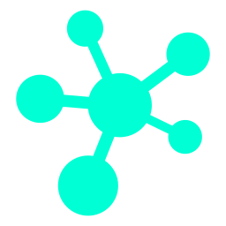

<p align="center">
  
</p>

<h1 align="center">Синапс</h1>

<p align="center">
  Портал навчальних робіт, досліджень і проєктів
  <br />
  <em>Синапс імені Тетяни Каришевої</em>
</p>

<p align="center">
  <a href="https://synapse-iris.vercel.app/">Відкрити портал</a>
  &nbsp;·&nbsp;
  <a href="#локальний-запуск">Запустити локально</a>
  &nbsp;·&nbsp;
  <a href="#архітектура">Переглянути архітектуру</a>
</p>

<p align="center">
  
  
  
  
</p>

---

## Про портал

Синапс перетворює навчальні роботи на окремі, структуровані вебсторінки. Тут поєднані зміст учнівських досліджень, редакційна ясність і цілісний візуальний стиль — від сторінки предмета до таблиць, карт і фотоматеріалів.

Проєкт задуманий як особистий освітній портал із потенціалом до розвитку: роботи мають постійні адреси, спільну оболонку та реєстр метаданих, а нові матеріали можуть долучатися до наявної структури без створення окремого сайту для кожного предмета.

> «Синапс імені Тетяни Каришевої» — авторський освітній проєкт Данила Павлюка.

## Візуальна мова

Інтерфейс побудований на спокійній нейтральній основі: теплий світлий фон, чітка типографіка, картки з м'якими кутами та виразні кольорові акценти. Manrope використовується для основного тексту, а JetBrains Mono — для технічних і компактних підписів.

Колірні акценти допомагають орієнтуватися в матеріалах, не змінюючи спільну структуру порталу:

| Розділ | Візуальний акцент |
| :--- | :--- |
| Біологія | Смарагдові та природні відтінки |
| Географія | Сині картографічні й теплі золотисті акценти |
| Українська мова | Медові та золотисті відтінки |

Світла й темна теми використовують спільні CSS-токени; тема запам'ятовується у браузері. Широкі екрани залишаються основним простором для перегляду, а мобільна версія зберігає ту саму візуальну ієрархію та пристосовує навігацію, щільність і медіа до вузького екрана.

## Матеріали

Портал організований за предметами. Кожна робота має власну адресу й відкривається безпосередньо за посиланням.

### Біологія

- **Таксономія Homo sapiens** — визначення положення виду в системі органічного світу.
- **Слони** — порівняння саванного та індійського слонів за критеріями виду.
- **Скрепі** — дослідження пріонного захворювання овець і кіз.

### Географія

- **Вторинний сектор економіки** — галузі промислового перетворення сировини.
- **Європа** — огляд населення та його просторового розподілу.
- **Азія** — регіональна характеристика за тематичною картою.
- **Рекреаційні ресурси Європи** — природні й культурні можливості для відпочинку.
- **Нідерланди** — країнознавче дослідження з фотогалереєю.
- **Порівняння держав Європи** — практична робота з порівняльними матеріалами.

### Українська мова

- **Пісні** — аналіз звукового складу української пісенної творчості.

## Можливості

- Окремі постійні посилання на роботи та предметні розділи.
- Спільна оболонка матеріалів із навігацією до відповідного предмета.
- Перемикання світлої й темної тем із запам'ятовуванням вибору.
- Предметні колірні палітри для орієнтації в порталі.
- Таблиці, карти, галереї та структуровані висновки для різних форматів навчальних робіт.
- Адаптація до широких і вузьких екранів без втрати змісту.
- Відкладене завантаження сторінок робіт і використання оптимізованих зображень.

## Технології

| Технологія | Роль у проєкті |
| :--- | :--- |
| React 19 | Компонентний інтерфейс |
| React Router 7 | Маршрутизація та пряме відкриття сторінок |
| Vite 8 | Розробка й production-збірка |
| CSS | Спільні токени, теми та модульні стилі сторінок |
| Manrope Variable | Основна типографіка |
| Oxlint | Перевірка коду |
| Vercel | Публікація порталу |

## Локальний запуск

### Потрібно

- Node.js **20.19+** або **22.12+**
- npm

### Встановлення та запуск

```bash
git clone https://github.com/kasatjk/synapse.git
cd synapse
npm install
npm run dev
```

Vite виведе адресу локального сервера, зазвичай `http://localhost:5173/`.

### Команди

```bash
npm run lint     # перевірити код
npm run build    # створити production-збірку в dist/
npm run preview  # переглянути production-збірку локально
```

## Архітектура

```text
synapse/
├── public/                  # favicon
├── src/
│   ├── assets/              # локальні зображення та медіа
│   ├── components/          # спільні оболонки й компоненти
│   │   ├── AppShell.jsx     # загальна навігація, теми й футер
│   │   ├── Subject.jsx      # каталог робіт предмета
│   │   ├── WorkCard.jsx     # картка роботи
│   │   ├── WorkShell.jsx    # оболонка окремої роботи
│   │   └── RegionMapOverview.jsx
│   ├── data/
│   │   └── works.js         # предмети, роботи й метадані маршрутів
│   ├── pages/               # головна та сторінки навчальних робіт
│   ├── styles/              # токени, базові та сторінкові стилі
│   ├── App.jsx              # маршрути й зіставлення сторінок із роботами
│   └── main.jsx             # запуск React і спільні стилі
├── index.html               # початкові метадані документа
├── package.json             # залежності та команди
├── vercel.json              # перенаправлення SPA-маршрутів
└── vite.config.js           # конфігурація Vite
```

Реєстр `src/data/works.js` є джерелом метаданих для робіт і предметів. Маршрути робіт у `src/App.jsx` будуються на його основі; самі React-компоненти робіт підвантажуються ліниво. Глобальні токени й спільне оформлення розміщені у `src/styles/`, а CSS окремої роботи імпортується безпосередньо її сторінкою.

## Додавання навчальної роботи

1. Створіть компонент у `src/pages/`, використовуючи `WorkShell` для спільного заголовка, навігації та структури звіту.
2. За потреби створіть файл стилів у `src/styles/` і імпортуйте його в компонент сторінки, а не в `main.jsx`.
3. Додайте метадані до масиву `works` у `src/data/works.js`:

   ```js
   {
     id: 'my-new-work',
     subject: 'geography',
     slug: 'my-new-work',
     path: '/geography/my-new-work',
     title: 'Назва роботи',
     shortTitle: 'Коротка назва',
     description: 'Короткий опис роботи.',
     documentTitle: 'Назва роботи | Географія | Синапс',
   }
   ```

4. У `src/App.jsx` створіть lazy-import сторінки та додайте компонент до `workPageComponents` під тим самим `id`. Маршрут з'явиться з реєстру автоматично.
5. Перевірте роботу командою `npm run lint` і зберіть портал через `npm run build`.

Щоб додати новий предмет, спершу внесіть його метадані до масиву `subjects` у `src/data/works.js`; сторінка предмета генерується спільним компонентом `Subject`.

## Публікація

Портал опублікований на [Vercel](https://vercel.com): [synapse-iris.vercel.app](https://synapse-iris.vercel.app/). Файл `vercel.json` перенаправляє запити сторінок на `index.html`, щоб прямі посилання React Router працювали після оновлення сторінки.

## Авторство

**Данило Павлюк** — концепція, дизайн і розробка порталу, підготовка навчальних матеріалів.

Проєкт присвячено **Тетяні Каришевій**.
